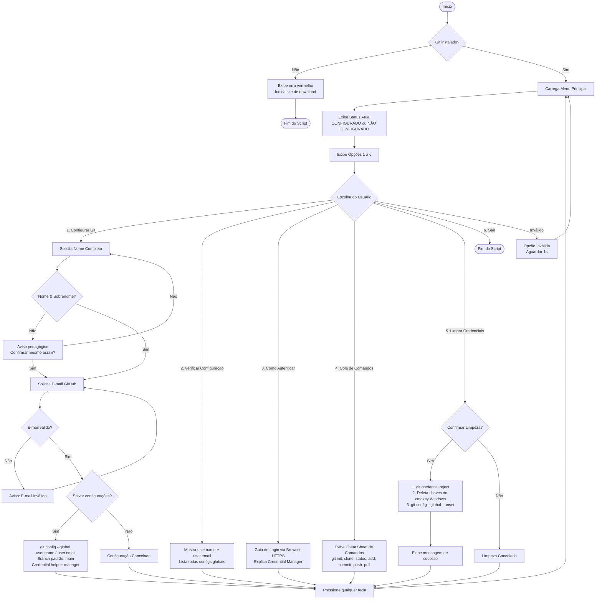

# 🛠️ Configurador do Git & GitHub para Laboratórios de Informática

Este projeto foi desenvolvido especialmente para ser utilizado em **computadores compartilhados de laboratórios de informática de escolas e faculdades**. Ele oferece uma solução simples, visual (interface de texto - TUI) e extremamente segura para que alunos configurem o Git e usem o GitHub em suas aulas práticas.

---

## 📂 Estrutura do Projeto

O projeto é composto por dois arquivos principais que devem estar na mesma pasta:

1. **`configurar-git.bat`**: Atalho executável (Lote do Windows). Permite que o estudante execute o script com **dois cliques**, sem precisar abrir o terminal manualmente ou alterar políticas de segurança globais do sistema.
2. **`configurar-git.ps1`**: Script PowerShell principal. Ele implementa a interface TUI (Text User Interface), gerencia as opções do menu, faz validações de e-mail e aplica comandos no Git.

---

## ✨ Funcionalidades Principais (Menu TUI)

O script interativo oferece 5 opções principais em um painel colorido no terminal:

*   **1. Configurar Meu Git (Nome e E-mail):** Pede o nome completo do aluno (evitando conflitos de autoria) e o e-mail cadastrado no GitHub. Configura esses dados globalmente no Git, define a branch padrão como `main` (padrão do GitHub) e habilita o assistente de credenciais.
*   **2. Verificar Configuração Atual:** Exibe em um painel formatado os dados que estão atualmente salvos na máquina (Nome, E-mail, Branch e Helper de credenciais).
*   **3. Como Fazer Login/Autenticar no GitHub:** Um pequeno guia em texto explicando a autenticação por HTTPS moderno. Ensina o aluno que ele não deve digitar a senha do GitHub no terminal, mas sim clicar no botão azul de autenticação que abrirá no navegador de forma totalmente automatizada.
*   **4. Guia Rápido de Comandos Básicos (Cola):** Uma folha de dicas ("cheat sheet") rápida que os alunos podem consultar diretamente no terminal com os principais comandos utilizados no dia a dia (`git init`, `git clone`, `git status`, `git add`, `git commit`, `git push`, `git pull`).
*   **5. Limpar Minhas Credenciais (LOGOUT - Segurança! 🔒):** A função mais crítica para laboratórios compartilhados. Ela remove de forma robusta e limpa todas as chaves de acesso salvas no Windows Credential Manager (`cmdkey`) e desconfigura o nome/e-mail globais do Git. Assim, o próximo aluno da próxima aula não terá acesso às chaves de segurança nem enviará códigos fingindo ser outra pessoa.
---

## 📊 Fluxograma de Funcionamento

O diagrama abaixo ilustra o fluxo completo do script `configurar-git.ps1`, incluindo as validações e as ações executadas por cada opção do menu interativo:

---

## 🚀 Como Implantar no Laboratório

Para implantar esses arquivos nas máquinas dos laboratórios de informática:

1.  **Copie os Arquivos:** Coloque os arquivos `configurar-git.bat` e `configurar-git.ps1` em um diretório público visível para os alunos nas máquinas, ou em uma pasta na rede compartilhada do laboratório.
2.  **Crie um Atalho:** É altamente recomendado criar um atalho do arquivo `configurar-git.bat` diretamente na **Área de Trabalho** dos computadores dos alunos, com um nome amigável como `"Configurar Git e GitHub"`.
3.  **Certifique-se de que o Git está Instalado:** O script fará uma verificação automática. Se o Git não estiver instalado na máquina, ele exibirá um aviso vermelho amigável instruindo o aluno a reportar ao professor e indicando o site de download oficial.

---

## 📖 Como Usar (Passo a Passo do Aluno)

1.  Dê **duplo clique** em `configurar-git.bat` para iniciar o assistente.
2.  Uma janela azul/escura do terminal se abrirá com o cabeçalho do projeto.
3.  Selecione a **Opção 1** para configurar seus dados pela primeira vez.
    *   Digite seu **Nome Completo** (Exemplo: `Maria Souza`) e aperte Enter.
    *   Digite seu **E-mail do GitHub** (Exemplo: `mariasouza@exemplo.com`) e aperte Enter.
    *   Confirme se os dados estão corretos digitando `S` e pressionando Enter.
4.  Quando for trabalhar com repositórios e o Windows solicitar autenticação, selecione **"Sign in with your browser"** (Entrar com seu navegador), autorize no navegador padrão e pronto! O Git cuidará do resto.
5.  **🚨 AO FINAL DA AULA (MUITO IMPORTANTE):**
    *   Abra novamente o atalho do Git na Área de Trabalho.
    *   Selecione a **Opção 5 (Limpar Minhas Credenciais)**.
    *   Confirme digitando `S` e pressionando Enter.
    *   Pronto! Seus dados pessoais e de acesso foram excluídos do computador com segurança.

---

## 💡 Dicas Pedagógicas para Professores

*   **Segurança em Primeiro Lugar:** No início da aula sobre controle de versão, mostre a importância da segurança de chaves. Demonstre a **Opção 5** no datashow e explique por que é crucial não deixar as credenciais do GitHub salvas em computadores públicos.
*   **Branch Padrão (`main`):** Historicamente, o Git local iniciava ramificações com o nome `master`. No entanto, o GitHub e toda a indústria de tecnologia adotaram o termo `main`. Nosso script já configura automaticamente `init.defaultBranch main`, eliminando o clássico erro que os alunos enfrentavam ao tentar fazer `git push origin master` e ver o GitHub rejeitar a criação direta.
*   **Autenticação Moderna:** Esqueça chaves SSH complexas no primeiro dia de aula de alunos iniciantes. O script ativa o `credential.helper manager` (Git Credential Manager) por padrão, o que permite o fluxo nativo de login seguro pelo navegador com 1 clique, ideal para ambientes Windows.

---
*Bons códigos e boas aulas!* 🚀
